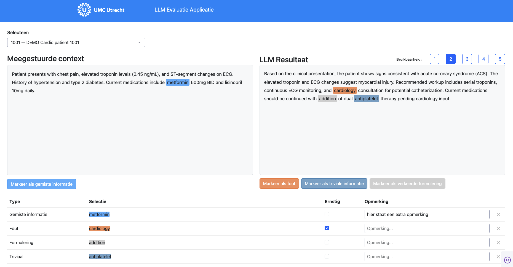

# LLM Evaluatie Applicatie

Met de LLM Evaluatie Applicatie beoordeel je tekst die door een taalmodel (LLM) is
gegenereerd. Je vergelijkt het **LLM resultaat** met de **meegestuurde context**
(de informatie die het model als input kreeg, bijvoorbeeld gegevens uit het
patiëntdossier) en legt vast wat er goed en fout gaat.

Per casus doe je twee dingen:

1. **Annoteren**: je markeert stukken tekst als gemiste informatie, fout, triviale
   informatie of verkeerde formulering, eventueel met een toelichting.
2. **Beoordelen**: je geeft het resultaat als geheel een bruikbaarheidsscore van 1
   tot 5.

!!! tip "Alles wordt automatisch opgeslagen"
    Er is geen opslaan-knop. Elke markering, ernst-vinkje, opmerking en score wordt
    direct in de database bewaard. Je kunt de applicatie op elk moment sluiten en
    later verdergaan waar je gebleven was.

---

## Het scherm in één oogopslag

| Onderdeel | Plaats | Functie |
|---|---|---|
| **Selecteer** | Linksboven | Keuzelijst met de casussen waartoe je toegang hebt. |
| **Meegestuurde context** | Linkervak | De input die het LLM heeft gekregen. |
| **LLM Resultaat** | Rechtervak | De tekst die het LLM heeft gegenereerd en die je beoordeelt. |
| **Bruikbaarheid 1–5** | Rechtsboven | Totaaloordeel over het LLM resultaat. |
| **Markeerknoppen** | Onder beide tekstvakken | Leggen de geselecteerde tekst vast als annotatie. |
| **Annotatietabel** | Onderaan | Overzicht van alle annotaties, met ernst, opmerking en verwijderknop. |

---

## Aan de slag

### 1. Inloggen en toegang

Je logt in met je UMC Utrecht-account. In de keuzelijst **Selecteer** zie je alleen
de casussen van de projecten en afdelingen waarvoor je bent geautoriseerd.

!!! info "Zie je geen casussen?"
    Dan heb je (nog) geen toegang tot een project. Neem contact op met het AI-team
    om toegang aan te vragen.

### 2. Een casus kiezen

Klik op de keuzelijst **Selecteer** en kies een casus. Elke casus heeft een nummer en
een korte omschrijving, bijvoorbeeld `1001 — DEMO Cardio patient 1001`.

Bij het openen van een casus worden de context, het LLM resultaat, alle eerder
gemaakte annotaties en de bruikbaarheidsscore direct geladen.

### 3. Lees beide teksten

Lees eerst de **meegestuurde context** en daarna het **LLM resultaat**. Beide vakken
kunnen scrollen als de tekst langer is dan het vak.

---

## Annoteren

### Soorten annotaties

Er zijn vier soorten annotaties. Elk soort heeft een eigen kleur, zodat je in de
tekst direct ziet wat er gemarkeerd is.

| Knop | Kleur | Gebruik in | Wanneer gebruik je deze? |
|---|---|---|---|
| **Markeer als gemiste informatie** | Lichtblauw | Meegestuurde context (links) | Informatie uit de context die belangrijk is, maar ontbreekt in het LLM resultaat. |
| **Markeer als fout** | Oranje | LLM resultaat (rechts) | Informatie die inhoudelijk onjuist is, niet klopt met de context, of verzonnen is. |
| **Markeer als triviale informatie** | Donkerblauw | LLM resultaat (rechts) | Informatie die wel klopt, maar overbodig of niet relevant is. |
| **Markeer als verkeerde formulering** | Grijs | LLM resultaat (rechts) | Inhoud die klopt, maar onduidelijk, onhandig of verkeerd verwoord is. |

!!! note "Welke kant?"
    *Gemiste informatie* markeer je altijd in de **context** (links): je wijst aan
    wat het model had moeten noemen. De andere drie soorten markeer je altijd in het
    **LLM resultaat** (rechts).

### Een annotatie toevoegen

1. **Selecteer tekst** door met de muis over een woord of zinsdeel te slepen (of
   dubbelklik op een woord).
2. Klik op de **markeerknop** onder hetzelfde tekstvak.
3. De tekst krijgt de bijbehorende kleur en er verschijnt een nieuwe regel in de
   annotatietabel.

!!! warning "Let op bij het selecteren"
    - Selecteer tekst **binnen één tekstvak**. Een selectie die over de rand van het
      vak loopt, wordt niet opgeslagen.
    - Gebruik de knop **onder het vak waarin je hebt geselecteerd**. Maak je een
      selectie links, gebruik dan *Markeer als gemiste informatie*; maak je een
      selectie rechts, gebruik dan een van de drie knoppen rechts.
    - Selecteer zo precies mogelijk: alleen het relevante woord of zinsdeel.

### Meldingen

Onder de knoppen kan een korte melding verschijnen:

| Melding | Betekenis | Wat te doen |
|---|---|---|
| ⚠ **Selecteer eerst tekst.** | Je klikte op een markeerknop zonder (geldige) selectie. | Selecteer eerst tekst in het juiste vak en klik opnieuw. |
| ℹ **Al gemarkeerd.** | Precies dit stuk tekst is al geannoteerd (ongeacht het soort). | Pas de bestaande annotatie aan in de tabel, of verwijder hem eerst. |

### Overlappende markeringen

Probeer overlappende annotaties te vermijden. Als twee annotaties elkaar overlappen,
staan ze allebei in de tabel, maar wordt in de tekst alleen de eerste (meest linkse)
gekleurd weergegeven.

---

## De annotatietabel

Onderaan het scherm staat de tabel met alle annotaties van de geopende casus.

| Kolom | Uitleg |
|---|---|
| **Type** | Het soort annotatie: Gemiste informatie, Fout, Triviaal of Formulering. |
| **Selectie** | De gemarkeerde tekst, in de kleur van het type. |
| **Ernstig** | Vink aan als de annotatie ernstig is, bijvoorbeeld omdat de fout of het gemis klinische gevolgen kan hebben. |
| **Opmerking** | Vrij tekstveld voor een toelichting, bijvoorbeeld wat er had moeten staan of waarom iets fout is. |
| **✕** | Verwijdert de annotatie. |

### Ernst aangeven

Klik op het vakje in de kolom **Ernstig**. De wijziging wordt direct opgeslagen. Klik
nogmaals om het vinkje weer weg te halen.

### Opmerking toevoegen of wijzigen

1. Klik in het veld **Opmerking...** en typ je toelichting.
2. Druk op ++enter++ of klik buiten het veld. De opmerking wordt dan opgeslagen.

Een bestaande opmerking pas je op dezelfde manier aan; wil je hem weghalen, maak het
veld dan leeg en druk op ++enter++.

!!! warning "Opmerking pas opgeslagen na Enter of wegklikken"
    Zolang de cursor nog in het opmerkingenveld staat, is de tekst nog niet
    opgeslagen. Druk op ++enter++ of klik ergens anders voordat je naar een andere
    casus gaat of de pagina sluit.

### Annotatie verwijderen

Klik op **✕** aan het einde van de regel. De annotatie verdwijnt uit de tabel en de
kleur verdwijnt uit de tekst.

!!! danger "Verwijderen kan niet ongedaan worden gemaakt"
    Er volgt geen bevestigingsvraag. Heb je per ongeluk iets verwijderd, maak de
    annotatie dan opnieuw aan (en vul ernst en opmerking opnieuw in).

### Het type van een annotatie wijzigen

Het type kan niet rechtstreeks worden aangepast. Verwijder de annotatie met **✕** en
markeer dezelfde tekst opnieuw met de juiste knop.

### De selectie aanpassen

Wil je een groter of kleiner stuk tekst markeren? Verwijder de bestaande annotatie met
**✕** en selecteer de tekst opnieuw.

---

## Bruikbaarheid beoordelen

Rechtsboven het LLM resultaat staan de knoppen **1** tot en met **5**. Hiermee geef je
een totaaloordeel over hoe bruikbaar het LLM resultaat is, waarbij **1** de laagste
en **5** de hoogste score is.

- Klik op een cijfer om een score te geven. De gekozen knop wordt donkerblauw en de
  score wordt direct opgeslagen.
- Klik op een ander cijfer om je score te wijzigen.

!!! tip "Eerst annoteren, dan scoren"
    Geef de bruikbaarheidsscore bij voorkeur ná het annoteren, zodat je oordeel
    gebaseerd is op alles wat je in de tekst bent tegengekomen.

!!! note
    Een eenmaal gegeven score kun je wel wijzigen, maar niet meer leegmaken.

---

## Eerdere annotaties blijven bewaard

Alles wat je vastlegt, wordt direct opgeslagen in de database:

- **Wisselen van casus** via de keuzelijst is altijd veilig. Kom je terug bij een
  eerdere casus, dan zie je al je annotaties, vinkjes, opmerkingen en de score weer
  terug.
- **De pagina sluiten of vernieuwen** is ook veilig; bij de volgende keer openen staat
  alles er nog.
- **Alles blijft aanpasbaar.** Je kunt op elk moment terugkeren naar een casus om
  annotaties toe te voegen, ernst en opmerkingen te wijzigen, annotaties te
  verwijderen of de score aan te passen. Er is geen moment waarop een casus wordt
  "afgesloten".

!!! info "Annotaties zijn gedeeld per casus"
    Annotaties en de bruikbaarheidsscore horen bij de casus, niet bij een individuele
    gebruiker. Iedereen met toegang tot dezelfde casus ziet dezelfde annotaties en
    score, en kan deze aanpassen. Spreek daarom binnen je project af wie welke
    casussen beoordeelt.

---

## Aanbevolen werkwijze

1. Kies een casus in de keuzelijst **Selecteer**.
2. Lees de **meegestuurde context** volledig.
3. Lees het **LLM resultaat** en markeer:
    - onjuiste informatie als **fout**;
    - overbodige informatie als **triviaal**;
    - onduidelijke of onhandige zinnen als **verkeerde formulering**.
4. Loop de context opnieuw door en markeer belangrijke informatie die in het LLM
   resultaat ontbreekt als **gemiste informatie**.
5. Vink in de tabel **Ernstig** aan waar dat van toepassing is en voeg waar nodig een
   **opmerking** toe (druk op ++enter++ om op te slaan).
6. Geef een **bruikbaarheidsscore** van 1 tot 5.
7. Ga door naar de volgende casus.

---

## Veelgestelde vragen

??? question "Moet ik ergens op 'opslaan' klikken?"
    Nee. Alles wordt automatisch opgeslagen. Alleen bij opmerkingen moet je even op
    ++enter++ drukken of buiten het veld klikken.

??? question "Ik klik op een markeerknop maar er gebeurt niets."
    Controleer of je tekst hebt geselecteerd in het vak boven de knop en of de
    selectie helemaal binnen dat vak valt. Verschijnt de melding *Selecteer eerst
    tekst*, selecteer dan opnieuw.

??? question "Ik heb het verkeerde type gekozen. Hoe pas ik dat aan?"
    Verwijder de annotatie met **✕** in de tabel en markeer de tekst opnieuw met de
    juiste knop.

??? question "Ik zie de melding 'Al gemarkeerd'."
    Exact hetzelfde stuk tekst is al geannoteerd. Pas de bestaande regel in de tabel
    aan, of verwijder die eerst als je een ander type wilt kiezen.

??? question "Kan ik een casus later nog aanpassen?"
    Ja. Annotaties en scores blijven bewaard en kunnen altijd worden aangepast.

??? question "Een annotatie staat wel in de tabel, maar is niet gekleurd in de tekst."
    Waarschijnlijk overlapt deze met een andere annotatie. In de tekst wordt bij
    overlap alleen de eerste annotatie gekleurd. Verwijder één van de twee als dat
    niet de bedoeling was.

??? question "Wat is het verschil tussen 'fout' en 'verkeerde formulering'?"
    Een **fout** is inhoudelijk onjuist: de informatie klopt niet. Bij een
    **verkeerde formulering** klopt de inhoud wel, maar is de manier waarop het
    verwoord is onduidelijk, onnatuurlijk of misleidend.
